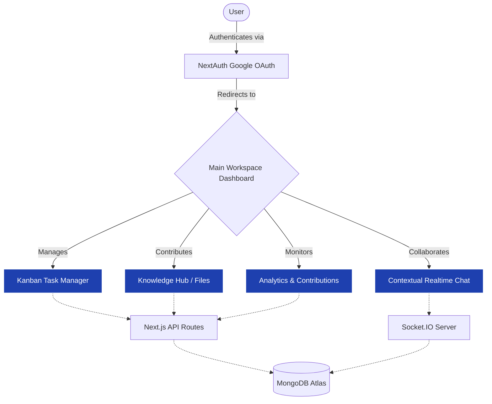

# 🧠 UniMind – Smart Knowledge Collaboration Platform

UniMind is a comprehensive collaboration platform meticulously designed for students, researchers, and distributed teams to **share knowledge, manage tasks, and stay seamlessly connected** within a unified workspace.  
Built leveraging the power of **Next.js, TailwindCSS, MongoDB, and Socket.IO**, UniMind provides an immersive **real-time collaborative experience** layered with a highly intuitive UI.

---

## 🚀 Application Flow & Architecture

The following flowchart illustrates the high-level data flow and user interaction inside the UniMind ecosystem:



---

## ✨ Comprehensive Features & Specifications

### 1. 🔑 Secure Authentication & Profiles
- **Google OAuth Integration:** Secure, passwordless login utilizing NextAuth.js.
- **User Activity Profiles:** Personalized user profiles that track individual contributions and activities.

### 2. 📂 Smart Knowledge Hub (File & Note Management)
- **Central Repository:** Upload structured files, share links, and collaborate on shared rich-text notes.
- **Knowledge Chain / Master Timeline:** Provides a chronological, unified view of all shared intelligence within the platform.
- **Member-wise Contribution View:** Drill down to see what specific resources each team member has brought to the table.

### 3. ✅ Kanban Task Manager
- **Interactive Board Layout:** Create and track tickets moving through dynamic statuses (To-Do, In-Progress, Done).
- **Task Assignments:** Assign ownership of distinct tasks to streamline workflow.
- **Status Filtering:** Quickly view pending vs. completed tasks to clear blockers and manage sprints.

### 4. 💬 Real-Time Contextual Chat Workspace
- **Instant Messaging Protocol:** Low-latency WebSockets implementation via Socket.IO enabling lag-free interactions.
- **Context-Bound Threads:** Discussions that live side-by-side with related tasks or file repositories rather than standalone distracting channels.

### 5. 📊 Interactive Analytics & Insights
- **Contribution Tracking metrics:** Visual charts dynamically generated via Recharts mapping activity surges, task completion rates, and file additions.
- **Project Pulse:** Gives administrators an immediate, eagle-eye view of team health and project momentum.

---

## 🛠 Tech Stack Specification

- **Frontend & App Framework:** Next.js (React 18), Next.js App / Pages routers  
- **Styling Architecture:** TailwindCSS, PostCSS, Autoprefixer, Radix UI primitives  
- **Authentication Protocol:** NextAuth.js (Google Providers)  
- **Database & ODM Engine:** MongoDB Atlas paired with Mongoose ORM  
- **Realtime Infrastructure:** Socket.IO / Node.js Custom Server  
- **Visualizations Lifecycle:** Axios (Data Fetching), Recharts (Graphing)  

---

## ⚙️ Getting Started & Running the Project

Follow these precise steps to set up the development environment successfully on your local machine:

### 1️⃣ Clone the Repository

```bash
git clone https://github.com/<your-username>/UniMind.git
cd UniMind/UniMind
```

### 2️⃣ Install System Dependencies

Make sure you have **Node.js v18+** installed. Then run:

```bash
npm install
```

### 3️⃣ Configure Environment Variables

Create your local environment override file by duplicating the provided template:

```bash
cp .env.example .env.local
```

Open `.env.local` and inject the required keys:
```env
MONGODB_URI=your_mongodb_connection_string
NEXTAUTH_URL=http://localhost:3000
GOOGLE_CLIENT_ID=your_google_client_id
GOOGLE_CLIENT_SECRET=your_google_client_secret
NEXTAUTH_SECRET=your_random_secret_string
NEXT_PUBLIC_SOCKET_URL=http://localhost:3001
```

### 4️⃣ Booting the Servers

UniMind operates with a Dual-Server configuration in development (Next.js Application Server + Socket.IO Event Server). You can utilize the included hybrid start scripts.

```bash
npm run dev:full
```
*(This command concurrently bootstraps both the Next.js client on port `3000` and the Node WebSocket layer on port `3001`)*

Open 👉 [http://localhost:3000](http://localhost:3000) inside your browser.

---

## 📜 Complete NPM Scripts Dictionary

- `npm run dev` : Start only the Next.js development server
- `npm run build` : Trigger an optimized production build (lint temporarily disabled via `--no-lint`)
- `npm run start` : Spin up the production-ready Next.js build
- `npm run server` : Start solely the standalone Socket.IO signaling server on port 3001
- `npm run dev:full` : **[RECOMMENDED]** Concurrently run the Next.js app and the Socket.IO event server
- `npm run dev:next` : Run only the Next frontend layer 
- `npm run dev:socket` : Run only the Socket backend layer
- `npm run lint` : Statically analyze the codebase (`.js`, `.ts`, `.tsx`) via ESLint

*Note: The Socket.IO process defaults to `http://localhost:3001`. If port 3000 is occupied, Next.js may dynamically jump to 3001 or 3002.*

---

## ✅ Initial Environment Verification

- **Styling check:** Confirm the Home Page is styled appropriately (Tailwind verification).
- **Database check:** Navigate to `/api/test` — validating a `{ success: true }` JSON payload.
- **Authentication check:** Sign in using the Google Provider and confirm the current user populates in your MongoDB cluster.

---

## 🤝 Contributing Workflow

We enforce a feature branch and explicit commit convention architecture:

1. **Checkout to a newly isolated module branch:**
    ```bash
    git checkout -b feature/your-awesome-feature
    ```
2. **Stage and commit your modifications:**
    ```bash
    git add .
    git commit -m "feat: integrate realtime presence tracking"
    git push origin feature/your-awesome-feature
    ```
3. **Open a comprehensive Pull Request** → Discuss Review Feedback → Merge into the main upstream branch.

---

## 📁 System Project Structure

```
UniMind/
├── .github/                   # Standardized PR templates & repo mechanics
│   └── PULL_REQUEST_TEMPLATE.md
├── components/                # React Presentational & Specialized UI Components
│   ├── sections/              # Chunked landing page segments
│   ├── ui/                    # Base Radix-UI heavily styled primitive modules
│   └── Navbar.js              
├── hooks/                     # Custom hooks logic (e.g., useSocket, useRealtimeUpdates)
├── lib/
│   └── mongodb.js             # Singleton DB Connection wrapper
├── models/                    # Mongoose Data Schemas 
│   ├── User.js, Task.js, Message.js, File.js, Contribution.js
├── pages/
│   ├── _app.js, _document.js  # App Shell overrides
│   ├── api/                   # SSR RESTful edge endpoints
│   └── (routes)               # Individual application subpages (/chat, /hub, /tasks)
├── public/                    # Root served Static branding and uploads output
├── styles/
│   └── globals.css            # Tailwind directive injects & fundamental overrides
├── server.js                  # Custom WebSocket Server definitions
├── next.config.mjs            # Next Compiler configurations
└── tailwind.config.js         # Base typography, utilities and branding theme 
```

---

## 📝 Final Development Notes

- **Version Binding:** Exclusively use **Node.js LTS (v18+)** to bypass build and crypto compatibility discrepancies. 
- **Styling Architecture:** When introducing generic visual modules, check `tailwind.config.js` prior to creating custom CSS. 
- **Issue Tracking:** Feel free to open a ticket in the issue tracker regarding anomalies spanning from missing environment triggers to compilation quirks.

---

